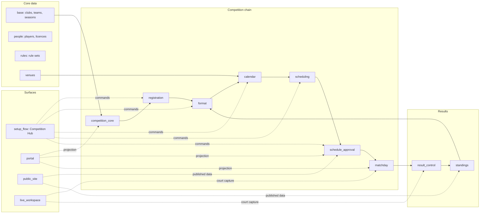

# Architecture overview

Owner: Federation Platform Team
Last reviewed: 2026-11-06
Review cadence: Every release

The platform is a set of focused Odoo 19 addons with one supported
installation entry point. This page explains the shape of the system and the
rules that keep it simple. Implementation conventions are in the
[technical reference](technical-reference.md); record ownership is in
[state and ownership](state-and-ownership.md); cross-cutting decisions are in
the [decision records](decisions/README.md).

## One entry point, focused addons

`sports_federation_app` is the only supported installation entry point. It is
dependency-only: it installs the production platform and moves or rewrites no
data.

```bash
# Production
odoo -d DATABASE -i sports_federation_app --stop-after-init

# Development and demonstrations
odoo -d DATABASE -i sports_federation_app,sports_federation_demo --stop-after-init
```

The domain addons remain the implementation and upgrade units. Existing
databases keep upgrading their installed addons. Merging addons physically
would complicate migrations without simplifying the operator experience, so
consolidation is allowed only when it removes real coupling and has a
rehearsed upgrade path (see [consolidation rule](#consolidation-rule)).

The [module catalogue](../overview/modules.md) lists every addon, its owner
and its dependency layer.

## How the pieces fit



- **Core data** (`base`, `people`, `rules`, `venues`) owns clubs, teams,
  seasons, players, licences, rule sets and venues.
- **The competition chain** hands work forward through explicit commands:
  registration finalizes participants, format freezes fixtures, calendar
  prepares capacity, scheduling assigns slots, approval publishes an immutable
  snapshot, and match day executes it. See the
  [competition model](competition-model.md).
- **Results** (`result_control`, `standings`) own the result lifecycle and
  standings; frozen stage standings feed format progression.
- **Club operations** (`rosters`, `officiating`, `duty_coverage`,
  `compliance`, `discipline`) extend matches and teams without owning the
  competition lifecycle.
- **Surfaces** (`setup_flow`, `portal`, `public_site`, `live_workspace`)
  present and route work. They call owner commands; they do not own
  competition state.
- **Platform operations** (`notifications`, `reporting`, `import_tools`,
  `governance`, `finance_bridge`) observe and support the domain addons.
- **Assembly** (`navigation`, `app`) loads last and only assembles menus and
  dependencies.

## Guided setup ownership

`federation.competition.setup.readiness.evaluate(edition)` decides the next
operator-facing setup step, progress, blocker hint and counts. The edition
projects that assessment into computed fields and routes **Continue Setup**
with the same assessment. Step actions stay on the edition; completed setup
opens the edition instead of inventing another task. Keep setup decisions out
of views and controllers.

## Navigation assembly

`sports_federation_navigation` is a cross-addon integration addon loaded after
its domain dependencies. It decides menu discoverability only: ordinary
operators get one competition entry, and raw or specialist menus require
**Advanced Federation Tools** or an owning specialist group. No model, table,
action XML ID, ACL, record rule, audit record or immutable snapshot moves
between addons. See [backend navigation](../user-guide/backend-navigation.md).

## Design rules

1. Put behaviour in the addon that owns the record being changed.
2. Use one explicit command for every protected workflow transition.
3. Keep controllers thin: parse input, call a model command, render output.
4. Do not add a second model for a concept that already has a canonical one.
5. Do not add an addon unless it can be installed or upgraded independently.
6. Use normal ACLs and record rules first; narrowly scoped elevation is the
   exception and must be inventoried (see
   [ADR-0001](decisions/0001-portal-trust-boundaries.md)).
7. Published schedules, approved results and audit evidence are immutable.
   Corrections use linked replacements.
8. Side effects such as notifications must not roll back business decisions.
9. Add a migration only when persisted data or ownership changes.
10. Prefer deleting obsolete compatibility code over adding another
    abstraction. New shared abstractions need at least two proven consumers.

## Consolidation rule

A physical addon merge is justified only when:

- the addons cannot be deployed independently;
- their models share one lifecycle owner;
- the merge removes a dependency or duplicate implementation;
- model names, tables, XML IDs and security identifiers stay stable;
- fresh install, same-version upgrade, supported-version upgrade and rollback
  pass.

## Where to go next

- [Technical reference](technical-reference.md): conventions, patterns,
  security, performance, reliability and testing.
- [State and ownership](state-and-ownership.md): canonical states and
  transition owners for the core records.
- [Readiness vocabulary](readiness-vocabulary.md): the shared status words and
  the single game-day readiness service.
- [Exception handling](exception-handling.md): how failures are caught and
  reported.
